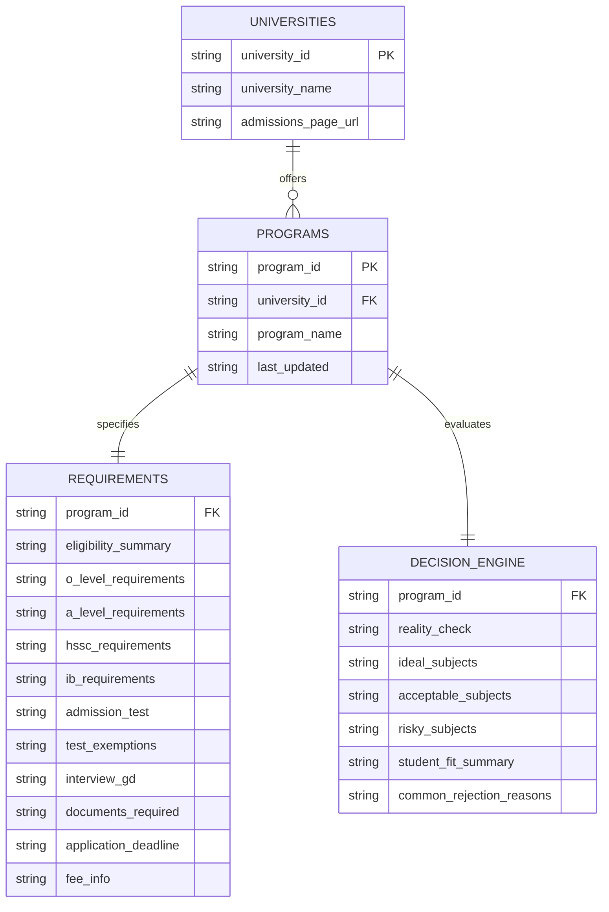

# 08 - University Admission Criteria & Eligibility Tool

> **Type:** Academic Diagnostic Tool / Multi-Sheet Decision Engine  
> **Brand / Project:** SJ Academy (`sjacademy.pk/university-requirements/` or embed widget)  
> **Target Audience:** O/A Level and FSc students in Pakistan checking subject compatibility and admission eligibility for LUMS, NUST, IBA, GIKI, FAST, AKU, and UET.

---

## 1. Overview & Decision Engine Architecture

The **University Admission Criteria Tool** is an eligibility checking engine that queries real-time criteria across **4 relational Google Sheets CSV feeds**.

### Core Capabilities:
1. **Relational Multi-Sheet Architecture:** Merges data asynchronously across:
   - **Universities Sheet (`gid=0`):** Institution metadata and official admissions URLs.
   - **Programs Sheet (`gid=359765089`):** Degree tracks tied to universities.
   - **Requirements Sheet (`gid=1322898919`):** Hard grade requirements (O/A Level, HSSC, IB), admission test rules (SAT/NET/IBA Test), exemptions, documents, deadlines, fees.
   - **Decision Engine Sheet (`gid=674053330`):** Qualitative admissions intelligence, competitive reality checks, ideal vs risky subject combinations, student fit criteria, and fatal rejection reasons.
2. **Cascading Dropdowns:** Selecting a university instantly filters and hydrates the program dropdown.
3. **Structured 5-Card Intelligence Output:**
   - *Card 1 (Full Width on Desktop):* **Eligibility & Tests** (O/A Level, HSSC, IB, Tests, Deadlines, Fees, Official link).
   - *Card 2 (Full Width Highlighted):* **Reality Check** (Contrast between official minimum eligibility vs. actual competitive cutoff).
   - *Card 3:* **Subject Strength Indicators** (Ideal A-Level subjects, Acceptable alternatives, Risky combinations).
   - *Card 4:* **Student Fit** (Academic profile alignment).
   - *Card 5:* **Common Rejection Reasons** (Bullet-point fatal mistakes).
4. **Caching & Refresh Controls:** 6-hour `localStorage` cache with a manual "Refresh Data" cache-busting trigger.

---

## 2. Design Tokens & Styling System

Scoped inside `#sja-uni-tool`.

| Token | Hex / Value | Purpose |
| :--- | :--- | :--- |
| `--sja-yellow` | `#FCE004` | Highlight gradient, tool badge, Reality Check top accent border |
| `--sja-light-yellow` | `#FFF9CC` | Reality Check gradient card background |
| `--sja-brown` | `#453516` | Standard card top accent borders, link hover color |
| `--sja-orange` | `#FE6100` | Primary action button, bullets marker, select focus halo |
| `--sja-black` | `#000000` | Headings, field labels, typography |
| `--sja-dark-grey` | `#222222` | Subtitles, body text |
| `--sja-grey` | `#555555` | Secondary text, status messages |
| `--sja-light-bg` | `#FAFAFA` | Controls background panel |
| `--sja-white` | `#FFFFFF` | Card surfaces and input backgrounds |

---

## 3. Relational Data Model



---

## 4. Google Sheets CSV Endpoints

| Sheet Entity | Published CSV URL Endpoint |
| :--- | :--- |
| **Universities** | `https://docs.google.com/spreadsheets/d/e/2PACX-1vSV3CMH_6AJw7BcRGz0dc3jMFA-RZ1NMS86HmIoi27mejqnyVSJO1kV4Xd_HsJQxVTSk060oAcToM1z/pub?gid=0&single=true&output=csv` |
| **Programs** | `https://docs.google.com/spreadsheets/d/e/2PACX-1vSV3CMH_6AJw7BcRGz0dc3jMFA-RZ1NMS86HmIoi27mejqnyVSJO1kV4Xd_HsJQxVTSk060oAcToM1z/pub?gid=359765089&single=true&output=csv` |
| **Requirements** | `https://docs.google.com/spreadsheets/d/e/2PACX-1vSV3CMH_6AJw7BcRGz0dc3jMFA-RZ1NMS86HmIoi27mejqnyVSJO1kV4Xd_HsJQxVTSk060oAcToM1z/pub?gid=1322898919&single=true&output=csv` |
| **Decision Engine** | `https://docs.google.com/spreadsheets/d/e/2PACX-1vSV3CMH_6AJw7BcRGz0dc3jMFA-RZ1NMS86HmIoi27mejqnyVSJO1kV4Xd_HsJQxVTSk060oAcToM1z/pub?gid=674053330&single=true&output=csv` |

---

## 5. Complete Source Code

```html
<link rel="preconnect" href="https://fonts.googleapis.com">
<link rel="preconnect" href="https://fonts.gstatic.com" crossorigin>
<link href="https://fonts.googleapis.com/css2?family=Poppins:wght@300;400;600;700;800&display=swap" rel="stylesheet">

<style>
/* ===== SJ ACADEMY BRANDING VARIABLES ===== */
:root {
  --sja-yellow: #FCE004;
  --sja-brown: #453516;
  --sja-black: #000000;
  --sja-orange: #FE6100;
  --sja-white: #ffffff;
  --sja-whatsapp: #25D366;
  --sja-grey: #555;
  --sja-dark-grey: #222;
  --sja-light-bg: #fafafa;
  --sja-light-yellow: #FFF9CC;
}

/* ===== MAIN TOOL CONTAINER ===== */
#sja-uni-tool {
  font-family: 'Poppins', sans-serif;
  color: var(--sja-black);
  line-height: 1.6;
  background-color: var(--sja-white);
  width: 100%;
  box-sizing: border-box;
}

#sja-uni-tool .sja-container {
  max-width: 1200px;
  margin: 0 auto;
  padding: 0 20px;
}

#sja-uni-tool .sja-header {
  background: #fff;
  padding: 60px 0 40px;
  position: relative;
  text-align: center;
}

#sja-uni-tool .sja-badge {
  display: inline-block;
  background-color: #fff;
  border: 2px solid var(--sja-black);
  border-radius: 50px;
  padding: 5px;
  margin-bottom: 25px;
  box-shadow: 4px 4px 0px rgba(0,0,0,0.15);
}

#sja-uni-tool .sja-mode-pill {
  padding: 8px 20px;
  border-radius: 40px;
  font-size: 0.85rem;
  font-weight: 700;
  text-transform: uppercase;
  display: inline-flex;
  align-items: center;
  gap: 8px;
  line-height: 1;
}

#sja-uni-tool .sja-mode-tool {
  background-color: var(--sja-yellow);
  color: var(--sja-black);
}

#sja-uni-tool .sja-title {
  font-size: 2.8rem;
  font-weight: 800;
  color: var(--sja-black);
  margin: 0 0 20px 0;
  line-height: 1.2;
}

#sja-uni-tool .sja-subtitle {
  font-size: 1.1rem;
  color: var(--sja-dark-grey);
  margin: 0 auto 30px;
  max-width: 700px;
}

.sja-highlight {
  background: linear-gradient(120deg, var(--sja-yellow) 0%, var(--sja-yellow) 100%);
  background-repeat: no-repeat;
  background-size: 100% 35%;
  background-position: 0 85%;
  display: inline;
  color: var(--sja-black);
  padding: 0 3px;
}

/* ===== CONTROLS SECTION ===== */
#sja-uni-tool .sja-controls {
  background: var(--sja-light-bg);
  padding: 50px 0;
  border-top: 1px solid #eee;
  border-bottom: 1px solid #eee;
}

#sja-uni-tool .sja-controls-grid {
  display: grid;
  grid-template-columns: 1fr;
  gap: 30px;
  max-width: 1000px;
  margin: 0 auto;
}

@media (min-width: 768px) {
  #sja-uni-tool .sja-controls-grid {
    grid-template-columns: 1fr 1fr;
  }
}

#sja-uni-tool .sja-field {
  margin-bottom: 0;
}

#sja-uni-tool .sja-field label {
  display: block;
  font-weight: 700;
  font-size: 14px;
  color: var(--sja-black);
  margin-bottom: 12px;
  text-transform: uppercase;
  letter-spacing: 0.5px;
}

#sja-uni-tool select {
  width: 100%;
  padding: 16px 20px;
  border: 2px solid #e5e5e5;
  background: var(--sja-white);
  font-size: 16px;
  font-weight: 500;
  color: var(--sja-black);
  border-radius: 5px;
  outline: none;
  transition: all 0.3s cubic-bezier(0.25, 0.46, 0.45, 0.94);
  appearance: none;
  background-image: url("data:image/svg+xml,%3Csvg xmlns='http://www.w3.org/2000/svg' width='12' height='12' fill='%23000000' viewBox='0 0 16 16'%3E%3Cpath d='M7.247 11.14 2.451 5.658C1.885 5.013 2.345 4 3.204 4h9.592a1 1 0 0 1 .753 1.659l-4.796 5.48a1 1 0 0 1-1.506 0z'/%3E%3C/svg%3E");
  background-repeat: no-repeat;
  background-position: right 20px center;
  background-size: 12px;
}

#sja-uni-tool select:focus {
  border-color: var(--sja-orange);
  box-shadow: 0 0 0 3px rgba(254, 97, 0, 0.1);
  transform: translateY(-2px);
}

#sja-uni-tool select:disabled {
  background-color: #f9f9f9;
  opacity: 0.7;
  cursor: not-allowed;
}

/* ===== ACTIONS BAR ===== */
#sja-uni-tool .sja-actions {
  grid-column: 1 / -1;
  display: flex;
  flex-direction: column;
  gap: 20px;
  align-items: center;
  margin-top: 10px;
}

@media (min-width: 768px) {
  #sja-uni-tool .sja-actions {
    flex-direction: row;
    justify-content: space-between;
    align-items: center;
  }
}

#sja-uni-tool .sja-btn {
  transition: all 0.3s cubic-bezier(0.25, 0.46, 0.45, 0.94);
  position: relative;
  overflow: hidden;
  text-decoration: none;
  border-radius: 5px;
  text-transform: uppercase;
  font-weight: 700;
  display: inline-block;
  cursor: pointer;
  border: 2px solid transparent;
  padding: 16px 35px;
  font-size: 15px;
}

#sja-uni-tool .sja-btn-primary {
  background-color: var(--sja-orange);
  color: var(--sja-white);
  border-color: var(--sja-orange);
  box-shadow: 0 4px 10px rgba(254, 97, 0, 0.3);
}

#sja-uni-tool .sja-btn-primary:hover {
  background-color: #e55800;
  border-color: #e55800;
  transform: translateY(-3px);
  box-shadow: 0 10px 20px rgba(254, 97, 0, 0.4);
}

#sja-uni-tool .sja-btn:disabled {
  background-color: #ccc;
  color: #666;
  border-color: #ccc;
  cursor: not-allowed;
  opacity: 0.6;
  transform: none;
  box-shadow: none;
}

#sja-uni-tool .sja-btn:disabled:hover {
  background-color: #ccc;
  border-color: #ccc;
  transform: none;
  box-shadow: none;
}

#sja-uni-tool .sja-refresh-link {
  color: var(--sja-grey);
  text-decoration: none;
  font-size: 14px;
  font-weight: 500;
  display: inline-flex;
  align-items: center;
  transition: color 0.2s ease;
  cursor: pointer;
}

#sja-uni-tool .sja-refresh-link:hover {
  color: var(--sja-orange);
  text-decoration: underline;
}

#sja-uni-tool .sja-refresh-link svg {
  transition: transform 0.3s ease;
}

#sja-uni-tool .sja-refresh-link:hover svg {
  transform: rotate(180deg);
}

#sja-uni-tool .sja-status {
  font-size: 14px;
  color: var(--sja-grey);
  padding: 12px 24px;
  background: rgba(255, 255, 255, 0.9);
  border-radius: 5px;
  border: 1px solid #eee;
  min-width: 200px;
  text-align: center;
}

/* ===== OUTPUT SECTION ===== */
#sja-uni-tool .sja-output {
  padding: 60px 0;
  background: #fff;
}

#sja-uni-tool .sja-output-grid {
  display: grid;
  grid-template-columns: 1fr;
  gap: 30px;
}

@media (min-width: 768px) {
  #sja-uni-tool .sja-output-grid {
    grid-template-columns: repeat(2, 1fr);
  }
}

@media (min-width: 992px) {
  #sja-uni-tool .sja-output-grid {
    grid-template-columns: repeat(3, 1fr);
  }
}

/* ===== CARDS ===== */
#sja-uni-tool .sja-card {
  background: #fff;
  padding: 30px;
  border-top: 6px solid var(--sja-brown);
  box-shadow: 0 10px 25px rgba(0,0,0,0.05);
  border-radius: 8px;
  transition: transform 0.3s ease, box-shadow 0.3s ease, border-color 0.3s ease;
  cursor: pointer;
  height: 100%;
  display: flex;
  flex-direction: column;
}

#sja-uni-tool .sja-card:hover {
  transform: translateY(-10px);
  box-shadow: 0 20px 40px rgba(0,0,0,0.1);
  border-top-color: var(--sja-orange);
}

#sja-uni-tool .sja-card h3 {
  color: var(--sja-black);
  font-weight: 700;
  font-size: 1.5rem;
  margin: 0 0 20px 0;
  line-height: 1.2;
}

/* Highlight Card (Reality Check) */
#sja-uni-tool .sja-highlight-card {
  border-top: 6px solid var(--sja-yellow);
  background: linear-gradient(135deg, var(--sja-light-yellow) 0%, #fff6b8 100%);
}

#sja-uni-tool .sja-highlight-card:hover {
  border-top-color: var(--sja-orange);
}

/* ===== KEY-VALUE PAIRS ===== */
#sja-uni-tool .sja-kv {
  flex-grow: 1;
}

#sja-uni-tool .sja-kv .row {
  margin-bottom: 20px;
  padding-bottom: 20px;
  border-bottom: 1px solid #eee;
}

#sja-uni-tool .sja-kv .row:last-child {
  margin-bottom: 0;
  padding-bottom: 0;
  border-bottom: none;
}

#sja-uni-tool .sja-kv .k {
  font-weight: 700;
  font-size: 14px;
  color: var(--sja-black);
  margin-bottom: 8px;
  text-transform: uppercase;
  letter-spacing: 0.3px;
}

#sja-uni-tool .sja-kv .v {
  font-size: 15px;
  color: #444;
  line-height: 1.6;
  white-space: pre-wrap;
}

/* ===== BULLETS LIST ===== */
#sja-uni-tool .sja-bullets {
  margin: 0;
  padding-left: 20px;
  flex-grow: 1;
}

#sja-uni-tool .sja-bullets li {
  margin: 10px 0;
  font-size: 15px;
  color: #444;
  line-height: 1.6;
  position: relative;
}

#sja-uni-tool .sja-bullets li::marker {
  color: var(--sja-orange);
  font-weight: bold;
}

/* ===== META INFO ===== */
#sja-uni-tool .sja-meta {
  font-size: 13px;
  color: #666;
  margin-top: 20px;
  padding-top: 20px;
  border-top: 1px solid #eee;
  font-style: italic;
}

#sja-uni-tool .sja-meta a {
  color: var(--sja-orange);
  text-decoration: none;
  font-weight: 600;
  transition: color 0.2s ease;
}

#sja-uni-tool .sja-meta a:hover {
  color: var(--sja-brown);
  text-decoration: underline;
}

/* ===== RESPONSIVE ADJUSTMENTS ===== */
@media (max-width: 767px) {
  #sja-uni-tool .sja-title { font-size: 2.2rem; }
  #sja-uni-tool .sja-header { padding: 40px 0 30px; }
  #sja-uni-tool .sja-controls { padding: 40px 0; }
  #sja-uni-tool .sja-output { padding: 40px 0; }
  #sja-uni-tool .sja-card { padding: 25px; }
  #sja-uni-tool .sja-actions { width: 100%; }
  #sja-uni-tool .sja-btn { width: 100%; text-align: center; }
  #sja-uni-tool .sja-status { width: 100%; }
}

@media (min-width: 992px) {
  #sja-uni-tool .sja-title { font-size: 3.8rem; }
  #sja-uni-tool .sja-card:nth-child(1),
  #sja-uni-tool .sja-card:nth-child(2) {
    grid-column: 1 / -1;
  }
}

/* ===== ACCESSIBILITY ===== */
#sja-uni-tool select:focus,
#sja-uni-tool .sja-btn:focus {
  outline: 3px solid var(--sja-orange);
  outline-offset: 2px;
}
</style>

<div id="sja-uni-tool">
  <div class="sja-container">
    <div class="sja-header">
      <div class="sja-badge">
        <div class="sja-mode-pill sja-mode-tool">
          <span>⚙️ Admission Criteria Tool</span>
        </div>
      </div>
      
      <h1 class="sja-title">Check Your Eligibility for <br><span class="sja-highlight">LUMS, NUST & IBA Admission Criteria</span></h1>
      
      <p class="sja-subtitle">
        Use our free University Requirements Checker to see if your grades and subject combination meet the official admission criteria for LUMS, NUST, IBA, GIKI, FAST, UET and other top universities in Pakistan. 
      </p>
    </div>

    <!-- Controls Section -->
    <div class="sja-controls">
      <div class="sja-controls-grid">
        <div class="sja-field">
          <label for="sja-university">University</label>
          <select id="sja-university">
            <option value="">Loading universities...</option>
          </select>
        </div>

        <div class="sja-field">
          <label for="sja-program">Program</label>
          <select id="sja-program" disabled>
            <option value="">Select a university first</option>
          </select>
        </div>

        <div class="sja-actions">
          <button class="sja-btn sja-btn-primary" id="sja-check-requirements" type="button" disabled>Check University Requirements</button>
          <a href="#" class="sja-refresh-link" id="sja-refresh">
            <svg width="14" height="14" viewBox="0 0 16 16" fill="none" xmlns="http://www.w3.org/2000/svg" style="display: inline-block; vertical-align: middle; margin-right: 6px;">
              <path d="M13.65 2.35C12.2 0.9 10.2 0 8 0C3.58 0 0 3.58 0 8s3.58 8 8 8c4.42 0 8-3.58 8-8h-2c0 3.31-2.69 6-6 6s-6-2.69-6-6 2.69-6 6-6c1.66 0 3.14.69 4.22 1.78L9 7h7V0l-2.35 2.35z" fill="currentColor"/>
            </svg>
            Refresh Data
          </a>
        </div>
      </div>
    </div>

    <!-- Output Grid -->
    <div id="sja-output" class="sja-output">
      <div class="sja-output-grid"></div>
    </div>
  </div>
</div>

<script>
(function(){
  const CONFIG = {
    universitiesCsvUrl: "https://docs.google.com/spreadsheets/d/e/2PACX-1vSV3CMH_6AJw7BcRGz0dc3jMFA-RZ1NMS86HmIoi27mejqnyVSJO1kV4Xd_HsJQxVTSk060oAcToM1z/pub?gid=0&single=true&output=csv",
    programsCsvUrl: "https://docs.google.com/spreadsheets/d/e/2PACX-1vSV3CMH_6AJw7BcRGz0dc3jMFA-RZ1NMS86HmIoi27mejqnyVSJO1kV4Xd_HsJQxVTSk060oAcToM1z/pub?gid=359765089&single=true&output=csv",
    requirementsCsvUrl: "https://docs.google.com/spreadsheets/d/e/2PACX-1vSV3CMH_6AJw7BcRGz0dc3jMFA-RZ1NMS86HmIoi27mejqnyVSJO1kV4Xd_HsJQxVTSk060oAcToM1z/pub?gid=1322898919&single=true&output=csv",
    decisionEngineCsvUrl: "https://docs.google.com/spreadsheets/d/e/2PACX-1vSV3CMH_6AJw7BcRGz0dc3jMFA-RZ1NMS86HmIoi27mejqnyVSJO1kV4Xd_HsJQxVTSk060oAcToM1z/pub?gid=674053330&single=true&output=csv",
    cacheHours: 6,
    whatsappNumber: "923362144454"
  };

  const els = {
    uni: document.getElementById("sja-university"),
    prog: document.getElementById("sja-program"),
    out: document.getElementById("sja-output"),
    refresh: document.getElementById("sja-refresh"),
    checkBtn: document.getElementById("sja-check-requirements")
  };

  const CACHE_KEY = "sja_uni_tool_cache_v1";

  function escapeHtml(str){
    return String(str ?? "")
      .replaceAll("&","&amp;")
      .replaceAll("<","&lt;")
      .replaceAll(">","&gt;")
      .replaceAll('"',"&quot;")
      .replaceAll("'","&#039;");
  }

  function parseCsv(csvText){
    const rows = [];
    let row = [];
    let cur = "";
    let inQuotes = false;

    for (let i = 0; i < csvText.length; i++){
      const ch = csvText[i];
      const next = csvText[i+1];

      if (ch === '"' && inQuotes && next === '"'){
        cur += '"';
        i++;
        continue;
      }

      if (ch === '"'){
        inQuotes = !inQuotes;
        continue;
      }

      if (ch === "," && !inQuotes){
        row.push(cur);
        cur = "";
        continue;
      }

      if ((ch === "\n" || ch === "\r") && !inQuotes){
        if (ch === "\r" && next === "\n") i++;
        row.push(cur);
        rows.push(row);
        row = [];
        cur = "";
        continue;
      }

      cur += ch;
    }

    row.push(cur);
    rows.push(row);

    const last = rows[rows.length - 1];
    if (last && last.length === 1 && last[0].trim() === "") rows.pop();

    const headers = rows.shift().map(h => h.trim());
    return rows
      .filter(r => r.some(c => String(c).trim() !== ""))
      .map(r => {
        const obj = {};
        headers.forEach((h, idx) => obj[h] = (r[idx] ?? "").trim());
        return obj;
      });
  }

  async function fetchCsv(url){
    const res = await fetch(url, { cache: "no-store" });
    if (!res.ok) throw new Error("Failed to fetch: " + url);
    const text = await res.text();
    return parseCsv(text);
  }

  function nowMs(){ return Date.now(); }

  function getCache(){
    try{
      const raw = localStorage.getItem(CACHE_KEY);
      if (!raw) return null;
      const parsed = JSON.parse(raw);
      const ageMs = nowMs() - parsed.savedAt;
      const maxMs = CONFIG.cacheHours * 60 * 60 * 1000;
      if (ageMs > maxMs) return null;
      return parsed.data;
    }catch(e){
      return null;
    }
  }

  function setCache(data){
    try{
      localStorage.setItem(CACHE_KEY, JSON.stringify({ savedAt: nowMs(), data }));
    }catch(e){}
  }

  function clearCache(){
    try{ localStorage.removeItem(CACHE_KEY); }catch(e){}
  }

  function option(el, value, label){
    const o = document.createElement("option");
    o.value = value;
    o.textContent = label;
    el.appendChild(o);
  }

  function resetPrograms(){
    els.prog.innerHTML = "";
    option(els.prog, "", "Select a university first");
    els.prog.disabled = true;
    els.checkBtn.disabled = true;
  }

  function splitCommaBullets(str){
    return String(str || "")
      .split(",")
      .map(s => s.trim())
      .filter(Boolean);
  }

  function renderAdmissionsLink(admissionsPageUrl){
    if (!admissionsPageUrl || admissionsPageUrl.trim() === "") {
      return "university admission criteria";
    }
    const safe = escapeHtml(admissionsPageUrl);
    return `<a href="${safe}" target="_blank" rel="noopener noreferrer">university admission criteria</a>`;
  }

  function renderCards(program, req, de, uni){
    const lastUpdated = req?.last_updated || program?.last_updated || "";
    const admissionsPageUrl = uni?.admissions_page_url || req?.admissions_page_url || "";

    const realityText = de?.reality_check || "Minimum eligibility does not guarantee admission. Competitive applicants typically have stronger grades. Subject choice impacts merit ranking.";

    const ideal = de?.ideal_subjects || "";
    const acceptable = de?.acceptable_subjects || "";
    const risky = de?.risky_subjects || "";

    const fit = de?.student_fit_summary || "";
    const reject = de?.common_rejection_reasons || "";

    const card1 = `
      <div class="sja-card">
        <h3>Eligibility and Tests</h3>
        <div class="sja-kv">
          ${kv("Eligibility summary", req?.eligibility_summary)}
          ${kv("O Level requirements", req?.o_level_requirements)}
          ${kv("A Level requirements", req?.a_level_requirements)}
          ${kv("HSSC requirements", req?.hssc_requirements)}
          ${kv("IB requirements", req?.ib_requirements)}
          ${kv("Admission test", req?.admission_test)}
          ${kv("Test exemptions", req?.test_exemptions)}
          ${kv("Interview or group discussion", req?.interview_gd)}
          ${kv("Documents required", req?.documents_required)}
          ${kv("Application deadline", req?.application_deadline)}
          ${kv("Fee info", req?.fee_info)}
        </div>
        <div class="sja-meta">Last updated: ${escapeHtml(lastUpdated)}. Based on official ${renderAdmissionsLink(admissionsPageUrl)}.</div>
      </div>
    `;

    const card2 = `
      <div class="sja-card sja-highlight-card">
        <h3>Reality Check</h3>
        <div class="sja-kv">
          <div class="row">
            <div class="v">${escapeHtml(realityText)}</div>
          </div>
        </div>
      </div>
    `;

    const card3 = `
      <div class="sja-card">
        <h3>Subject Strength Indicators</h3>
        <div class="sja-kv">
          ${kv("Ideal A Level subjects", ideal)}
          ${kv("Acceptable alternatives", acceptable)}
          ${kv("Risky combinations", risky)}
        </div>
      </div>
    `;

    const card4 = `
      <div class="sja-card">
        <h3>Student Fit</h3>
        <div class="sja-kv">
          <div class="row">
            <div class="v">${escapeHtml(fit || "Not provided yet.")}</div>
          </div>
        </div>
      </div>
    `;

    const rejects = splitCommaBullets(reject);
    const rejectHtml = rejects.length
      ? `<ul class="sja-bullets">${rejects.map(x => `<li>${escapeHtml(x)}</li>`).join("")}</ul>`
      : `<div class="row"><div class="v">Not provided yet.</div></div>`;

    const card5 = `
      <div class="sja-card">
        <h3>Common Rejection Reasons</h3>
        ${rejectHtml}
      </div>
    `;

    const outputGrid = els.out.querySelector('.sja-output-grid');
    outputGrid.innerHTML = card1 + card2 + card3 + card4 + card5;
  }

  function kv(key, val){
    const safeVal = escapeHtml(val || "Not provided yet.");
    return `
      <div class="row">
        <div class="k">${escapeHtml(key)}</div>
        <div class="v">${safeVal}</div>
      </div>
    `;
  }

  let DATA = {
    universities: [],
    programs: [],
    requirements: [],
    decisionEngine: []
  };

  function hydrateUniversityDropdown(){
    els.uni.innerHTML = "";
    option(els.uni, "", "Select a university");

    const uniques = new Map();
    DATA.universities.forEach(u => {
      const name = u.university_name;
      if (!name) return;
      uniques.set(name, u.university_id);
    });

    Array.from(uniques.entries())
      .sort((a,b) => a[0].localeCompare(b[0]))
      .forEach(([name, id]) => option(els.uni, id, name));
  }

  function hydrateProgramsForUniversity(universityId){
    els.prog.innerHTML = "";
    option(els.prog, "", "Select a program");

    const progs = DATA.programs
      .filter(p => p.university_id === universityId)
      .sort((a,b) => a.program_name.localeCompare(b.program_name));

    progs.forEach(p => option(els.prog, p.program_id, p.program_name));
    els.prog.disabled = false;

    const outputGrid = els.out.querySelector('.sja-output-grid');
    if (outputGrid) {
      outputGrid.innerHTML = "";
    }
  }

  function getUniversityById(universityId){
    return DATA.universities.find(u => u.university_id === universityId) || null;
  }

  function getProgramById(programId){
    return DATA.programs.find(p => p.program_id === programId) || null;
  }

  function getRequirementsByProgramId(programId){
    return DATA.requirements.find(r => r.program_id === programId) || null;
  }

  function getDecisionEngineByProgramId(programId){
    return DATA.decisionEngine.find(d => d.program_id === programId) || null;
  }

  async function loadAll(force=false){
    try{
      els.uni.disabled = true;
      resetPrograms();
      
      const outputGrid = els.out.querySelector('.sja-output-grid');
      if (outputGrid) {
        outputGrid.innerHTML = "";
      }

      if (!force){
        const cached = getCache();
        if (cached){
          DATA = cached;
          els.uni.disabled = false;
          hydrateUniversityDropdown();
          return;
        }
      }

      const [universities, programs, requirements, decisionEngine] = await Promise.all([
        fetchCsv(CONFIG.universitiesCsvUrl),
        fetchCsv(CONFIG.programsCsvUrl),
        fetchCsv(CONFIG.requirementsCsvUrl),
        fetchCsv(CONFIG.decisionEngineCsvUrl)
      ]);

      DATA = { universities, programs, requirements, decisionEngine };
      setCache(DATA);

      els.uni.disabled = false;
      hydrateUniversityDropdown();
    }catch(err){
      const outputGrid = els.out.querySelector('.sja-output-grid');
      if (outputGrid) {
        outputGrid.innerHTML = `
          <div class="sja-card">
            <h3>Could not load data</h3>
            <div class="sja-kv">
              <div class="row">
                <div class="v">Make sure each tab is published as CSV, then paste those URLs into the CONFIG section inside this HTML.</div>
              </div>
            </div>
          </div>
        `;
      }
      console.error(err);
    }
  }

  els.uni.addEventListener("change", () => {
    const uniId = els.uni.value;
    resetPrograms();
    els.checkBtn.disabled = true;
    const outputGrid = els.out.querySelector('.sja-output-grid');
    if (outputGrid) {
      outputGrid.innerHTML = "";
    }
    if (!uniId) return;
    hydrateProgramsForUniversity(uniId);
  });

  els.prog.addEventListener("change", () => {
    const programId = els.prog.value;
    const outputGrid = els.out.querySelector('.sja-output-grid');
    if (outputGrid) {
      outputGrid.innerHTML = "";
    }
    els.checkBtn.disabled = !programId;
  });

  els.checkBtn.addEventListener("click", () => {
    const programId = els.prog.value;
    if (!programId) return;

    const prog = getProgramById(programId);
    const req = getRequirementsByProgramId(programId);
    const de = getDecisionEngineByProgramId(programId);

    const uni = getUniversityById(prog?.university_id || "");
    const programForRender = {
      program_id: prog?.program_id || "",
      program_name: prog?.program_name || "",
      university_name: uni?.university_name || "",
      last_updated: prog?.last_updated || ""
    };

    renderCards(programForRender, req, de, uni);
  });

  els.refresh.addEventListener("click", (e) => {
    e.preventDefault();
    clearCache();
    loadAll(true);
  });

  loadAll(false);
})();
</script>
